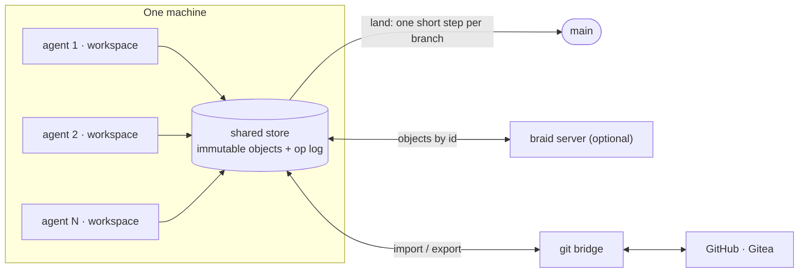

<div align="center">


# ✳ Elffuss Braid

**Version control for repositories where many agents land changes at the same time.**

A from-scratch version control system in Rust. Creating a change costs what the
change touches, not what the repository weighs. Landing on `main` is one short
step per branch, with no repository-wide lock. Git stays at the edges, so GitHub
keeps working.

[](LICENSE)
[](https://github.com/KikoCis/elffuss-braid/actions/workflows/ci.yml)
[](https://www.rust-lang.org)
[](#status-and-roadmap)

[elffuss.com](https://elffuss.com) · [Code](https://code.elffuss.com) · [Claw](https://claw.elffuss.com) · [Translator](https://translator.elffuss.com) · [Copilot](https://copilot.elffuss.com) · [Blog](https://elffuss.com/blog/) · [Hugging Face](https://huggingface.co/KikoCis) · [Dev log](https://bitacora.utopiaia.com/)

</div>

---

**In this repository:** [why braid](#why-braid) · [how it works](#how-it-works) · [quick start](#quick-start) · [working with git](#working-with-git) · [design](#design) · [status](#status-and-roadmap) · [what is honest about this](#what-is-honest-about-this) · [credits](#prior-art-and-credits)

---

## Why braid

Git was designed for people who work offline and sync now and then. Agents work
differently: there are many of them, each change is small, they are always
connected, and they all want to land on `main` at once. In git that shows up as:

- **Shared mutable state.** One index per working tree, and a push that is
  rejected whenever someone else landed first, so every agent ends up in a
  fetch, rebase, push and retry loop.
- **Costs that grow with the repository.** Status and commit walk the whole
  index, and a directory with many files is rewritten whole on every change.
- **Transfers built per client.** Each fetch negotiates and builds its own pack,
  so a cache in front of the server cannot help.
- **Large files need a side system.**

Braid starts from the opposite assumptions:

| | git | braid |
|---|---|---|
| Unit of change | a commit: a full tree snapshot | a changeset: the files that changed against the first parent, plus the root tree id |
| Landing on `main` | the client pushes and is rejected if behind | `land` rebases in one short serial step per branch, at a cost that follows the change |
| Many writers | one index per working tree | one workspace per agent over a shared append-only store; creating a change takes no repository lock |
| Fetching | negotiated packs, unique per client | immutable objects by id, so any cache (local daemon, nginx, CDN) can serve them |
| Large directories | rewritten whole on every change | split into content-defined nodes; an edit rewrites only its path |
| Large files | a separate extension | content-defined chunks, deduplicated across versions |
| Hash | SHA-1 | BLAKE3 |
| For agents | parse human output | `--json` everywhere; changes can be created through the API without a checkout |

This is the design. [Status](#status-and-roadmap) says what exists today.

## How it works



1. **Everything is an immutable object named by its BLAKE3 hash:** file
   contents, directories, and changesets. Nothing is ever rewritten in place.
2. **A changeset records what changed against its first parent,** plus the
   root tree it produces. History, blame and rebase read the short list; the
   root id commits to the whole repository.
3. **Landing is one short serial step per branch.** If the change was built on
   the current head it fast-forwards. If not, braid rebases it path by path and
   merges only the files both sides touched. Conflicts come back as data that
   an agent can act on.
4. **Many processes share one store without a daemon.** Segments are leased
   with locks the kernel releases if a process dies, objects are published
   before anything refers to them, and an append-only op log records every
   operation so it can be undone.
5. **The same API at every tier.** A local store, a per-machine daemon, a
   cache and a server answer the same requests, so a client never cares which
   one it talks to.

## Quick start

Today braid computes object ids, and its hashed format is frozen and verified.
Storing data arrives with milestone 2.

```bash
git clone https://github.com/KikoCis/elffuss-braid
cd elffuss-braid
cargo build --release
./target/release/braid --version
./target/release/braid hash-object README.md
./target/release/braid hash-object --json README.md
```

Ids can be checked with any BLAKE3 implementation, for example the reference
[`b3sum`](https://github.com/BLAKE3-team/BLAKE3/tree/master/b3sum) tool:

```bash
b3sum --derive-key "elffuss-braid 2026 blob v1" README.md
```

## Working with git

Repositories come in with their whole history and keep a git mirror.

- `braid git import` reads a git repository through
  [gitoxide](https://github.com/GitoxideLabs/gitoxide). Each commit is exported
  again and compared with the original, so the round trip is bit for bit.
- `braid git export` and `braid git sync` keep GitHub or Gitea up to date as a
  fast-forward with a lease. Braid never force-pushes.
- Braid contains no code from git itself, which is GPLv2. It reads and writes
  git data with gitoxide (MIT or Apache-2.0) and runs the `git` binary only as
  a subprocess to push.

## Design

- [Design overview](docs/design.md): store, landing, workspaces, the git
  bridge, the server, and how it is tested.
- [Format v1](docs/spec/format-v1.md): the exact bytes of ids, trees and
  changesets, with golden vectors.

## Status and roadmap

| Milestone | Scope | State |
|---|---|---|
| 0 | Public repository, CI, object ids, `braid hash-object` | ✅ done |
| 1 | Format v1: canonical codec, trees (flat and split), changesets, name rules; frozen | ✅ done |
| 2 | Local store and op log: many processes, crash-safe, `fsck`, `undo` | next |
| 3 | History and the git bridge: import, export, `log`, `show`, `diff`, `blame` | planned |
| 4 | Many agents on one machine: workspaces, `land`, conflicts, `git sync` | planned |
| 5 | Performance: deltas, chunking, derived indexes, benchmarks against git | planned |
| 6 | Server: lazy sparse clones, tokens, caching tiers | planned |
| 7 | Daemon, virtual file system, WebAssembly core | planned |

Each milestone ships when its tests pass: golden vectors and fuzzing for the
format, crash and many-process tests for the store, bit-for-bit round trips and
differential tests against git for the bridge, deterministic simulation for
landing.

## What is honest about this

- **It is pre-alpha.** Today it computes object ids and encodes the frozen
  format; it does not store anything yet. Do not keep anything in it that you
  cannot afford to lose.
- **No performance claims yet.** When benchmarks land they will be ratios
  against git on the same machine, with the script that reproduces them, never
  numbers nobody can check.
- **The hashed format is frozen** and every golden vector is recomputed by a
  second implementation written from the specification alone. Storage and
  protocols can still change.
- **Braid is not Scion.** It starts from the ideas Anthropic described in
  public about its own source control system. It is an independent
  implementation, contains no code from Anthropic, and is not affiliated with
  or endorsed by Anthropic.
- **Platforms.** CI tests Linux and other Unix-like systems. Windows is not tested yet.

## Part of Elffuss

Braid is part of [Elffuss](https://elffuss.com), a family of tools for building
software with agents.

- [elffuss](https://github.com/KikoCis/elffuss): the shared browser-agent core behind Code and Claw.
- [elffuss-code](https://github.com/KikoCis/elffuss-code): an IDE with an AI agent that runs entirely in your browser ([Space](https://huggingface.co/spaces/KikoCis/elffuss-code)).
- [elffuss-claw](https://github.com/KikoCis/elffuss-claw): an agentic OS in your browser, with apps generated on demand ([Space](https://huggingface.co/spaces/KikoCis/elffuss-claw)).
- [elffuss-engine](https://github.com/KikoCis/elffuss-engine): an LLM runtime that runs GGUF models on WebGPU.
- [elffuss-translator](https://github.com/KikoCis/elffuss-translator): real-time conversation translation in the browser.

## Prior art and credits

- Anthropic, [Redesigning source control at Anthropic](https://www.anthropic.com/engineering/redesigning-source-control):
  changesets stored against the first parent, server-side merges, minimal
  branch state, immutable objects served by any cache tier.
- [Jujutsu](https://github.com/jj-vcs/jj): the operation log and undo.
- [Sapling](https://sapling-scm.com): history served at scale, and compressing
  a file version against the previous one.
- [gitoxide](https://github.com/GitoxideLabs/gitoxide): the git bridge.
- [BLAKE3](https://github.com/BLAKE3-team/BLAKE3), [FastCDC](https://www.usenix.org/conference/atc16/technical-sessions/presentation/xia),
  [prolly trees](https://docs.dolthub.com/architecture/storage-engine/prolly-tree)
  and [imara-diff](https://github.com/pascalkuthe/imara-diff).

## Contributing and security

- [CONTRIBUTING.md](CONTRIBUTING.md): how to build, test and propose changes.
- [SECURITY.md](SECURITY.md): how to report a vulnerability privately.

## License

[Apache-2.0](LICENSE). Copyright 2026 UtopiaIA. See [NOTICE](NOTICE).

---

## En castellano

Braid es un sistema de control de versiones escrito de cero en Rust, para
repositorios en los que muchos agentes aterrizan cambios a la vez.

- Crear un cambio cuesta lo que toca el cambio, no lo que pesa el repositorio.
- Aterrizar en `main` es un paso corto por rama, sin cerrojo global.
- Git se queda en los bordes, así que GitHub y Gitea siguen funcionando.

Parte de las ideas que Anthropic contó en público sobre Scion, su sistema interno.
Es una implementación independiente, sin código de Anthropic y sin relación con
la empresa.

Hoy está en pre-alfa: calcula ids y tiene el formato v1 congelado y verificado,
pero todavía no guarda datos. Las [fases](#status-and-roadmap)
dicen qué llega después y qué pruebas tiene que pasar cada una.
