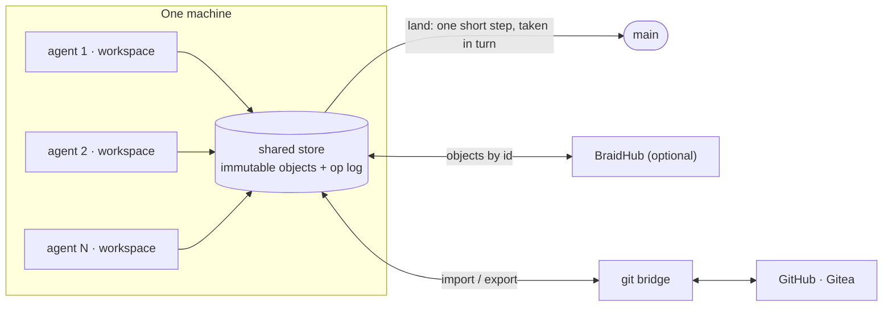

<div align="center">


# ✳ Elffuss Braid

**Version control for repositories where many agents land changes at the same time.**

A from-scratch version control system in Rust. Creating a change costs what the
change touches, not what the repository weighs. Agents commit in parallel, and
landing on `main` is one short step they take in turn. Git stays at the edges,
so GitHub keeps working.

[](LICENSE)
[](https://github.com/KikoCis/elffuss-braid/actions/workflows/ci.yml)
[](https://www.rust-lang.org)
[](#status-and-roadmap)
[](docs/spec/format-v1.md)

[](https://braid.elffuss.com)
[](https://huggingface.co/spaces/KikoCis/elffuss-braid)
[](AGENTS.md)
[](https://braid.elffuss.com/llms.txt)
[](https://braidhub.elffuss.com)
[](CONTRIBUTING.md)
[](https://github.com/KikoCis/elffuss-braid/commits/main)

[elffuss.com](https://elffuss.com) · [Code](https://code.elffuss.com) · [Claw](https://claw.elffuss.com) · [Translator](https://translator.elffuss.com) · [Copilot](https://copilot.elffuss.com) · [Blog](https://elffuss.com/blog/) · [Hugging Face](https://huggingface.co/KikoCis) · [Dev log](https://bitacora.utopiaia.com/)

<br>


<sub>The real CLI, recorded by <a href="scripts/demos/render.sh"><code>scripts/demos/render.sh</code></a>: three agents, one <code>main</code>.</sub>

</div>

---

**In this repository:** [why braid](#why-braid) · [how it works](#how-it-works) · [use it from your agent](#use-it-from-your-agent) · [quick start](#quick-start) · [working with git](#working-with-git) · [BraidHub](#braidhub) · [design](#design) · [status](#status-and-roadmap) · [what is honest about this](#what-is-honest-about-this) · [measured against git](#measured-against-git) · [credits](#prior-art-and-credits)

---

## Why braid

Git was designed for people who work offline and sync now and then. Agents work
differently: there are many of them, each change is small, they are always
connected, and they all want to land on `main` at once. In git that shows up as:

- **Shared mutable state.** One index per working tree, and a push that is
  rejected whenever someone else landed first, so every agent ends up in a
  fetch, rebase, push and retry loop.
- **Costs that grow with the repository.** Status and commit walk the whole
  index, and a directory with many files is rewritten whole on every change.
- **Transfers built per client.** Each fetch negotiates and builds its own pack,
  so a cache in front of the server cannot help.
- **Large files need a side system.**

Braid starts from the opposite assumptions:

| | git | braid |
|---|---|---|
| Unit of change | a commit: a full tree snapshot | a changeset: the files that changed against the first parent, plus the root tree id |
| Landing on `main` | the client pushes and is rejected if behind | `land` rebases in one short step that landings take in turn, at a cost that follows the change |
| Many writers | one index per working tree | one workspace per agent over a shared append-only store; creating a change takes no repository lock |
| Fetching | negotiated packs, unique per client | immutable objects by id, so any cache (local daemon, nginx, CDN) can serve them |
| Large directories | rewritten whole on every change | split into content-defined nodes; an edit rewrites only its path |
| Large files | a separate extension | content-defined chunks, deduplicated across versions |
| Hash | SHA-1 | BLAKE3 |
| For agents | parse human output | `--json` everywhere; changes can be created through the API without a checkout |

This is the design. [Status](#status-and-roadmap) says what exists today.

## How it works



1. **Everything is an immutable object named by its BLAKE3 hash:** file
   contents, directories, and changesets. Nothing is ever rewritten in place.
2. **A changeset records what changed against its first parent,** plus the
   root tree it produces. History, blame and rebase read the short list; the
   root id commits to the whole repository.
3. **Agents commit in parallel; landing is one short step they take in turn.**
   If the change was built on the current head it fast-forwards. If not,
   braid rebases it path by path and merges only the files both sides
   touched. Conflicts come back as data that an agent can act on.
4. **Many processes share one store without a daemon.** Segments are leased
   with locks the kernel releases if a process dies, objects are published
   before anything refers to them, and an append-only op log records every
   operation so it can be undone.
5. **The same API at every tier.** A local store, a per-machine daemon, a
   cache and a server answer the same requests, so a client never cares which
   one it talks to. The server has its first version, BraidHub; the caches
   and the daemon are planned (milestones 6 and 7).

## Use it from your agent

Braid comes with instructions written for coding agents. In a project that
is a git repository, ask your agent, whatever harness runs it:

```text
Install braid in this project and set it up for agents, following https://braid.elffuss.com/agents.md (read it whole, with curl -fsSL)
```

It installs braid with cargo, tells you what in the project braid does not
run, such as git hooks, offers to make a git remote if the project has
none, imports the project's git history, and writes the rules for agents
into the project's `AGENTS.md` with `braid agents init`.
From then on, every agent session works in a braid workspace of its own,
where git refuses to run, lands through braid, and tells you when what it
landed is waiting for a sync to the git remote. Git stays the source of
truth, and in a clone where braid is not set up, agents work with git as
before. The instructions are part 1 of [AGENTS.md](AGENTS.md), which the
site serves as
[braid.elffuss.com/agents.md](https://braid.elffuss.com/agents.md), next to
an [llms.txt](https://braid.elffuss.com/llms.txt).

<p align="center"></p>

### Set it up by hand

The same steps, for a git checkout on its main branch with nothing to
commit, where git has a `user.name` and a `user.email`. [agents.md](https://braid.elffuss.com/agents.md) says what to check
first (git hooks, submodules, LFS, a branch that takes only pull requests)
and what to do when a step fails.

```bash
cargo install --locked --git https://github.com/KikoCis/elffuss-braid --tag v0.1.0 elffuss-braid-cli
braid init                       # .braid/: the store and the agents' workspaces
mkdir -p "$(git rev-parse --git-path info)"
echo .braid >> "$(git rev-parse --git-path info/exclude)"   # git ignores braid, in this checkout only
printf 'name = %s\nemail = %s\n' "$(git config user.name)" "$(git config user.email)" > .braid/config
braid git import .               # the project's whole history
touch CLAUDE.md                  # only if agents work here with Claude Code
braid agents init                # the rules for agents, into AGENTS.md
git add AGENTS.md CLAUDE.md      # leave CLAUDE.md out if there is none
git commit -m "Set up braid for agents"
braid git import .               # braid's main takes that commit
```

### What goes into your Markdown files

Agents follow braid because the project tells them to, in the files their
harness reads at the start of every session. `braid agents init` writes
them, and they are committed with git, so every clone and every new session
has them:

- **`AGENTS.md`**, which most coding agents read: a section between two
  marker lines, with the rules every session follows. Running
  `braid agents init` again, after a braid upgrade for example, rewrites the
  section in place and never touches the rest of the file. It begins:

  ```markdown
  <!-- braid:start -->
  <!-- Written by `braid agents init` (branch: main). Running it
       again rewrites everything between the braid markers. -->
  ## Version control with braid

  Agents land their changes on `main` through [braid](https://braid.elffuss.com),
  each in a braid workspace of its own. Git stays the source of truth, and
  `braid git sync` keeps the git remote in step.
  ```

  The rules, in short: they apply only where the checkout has a `.braid`
  directory, so a fresh clone or CI works with git as before; never edit
  files or use git in the project root, which is the user's shared
  checkout; each session works in a workspace of its own under
  `.braid/work/`, and commits and lands with braid, naming itself with
  `--agent`; on a conflict (exit status 2), `braid update`, fix the
  markers, commit and land again; `braid update` before a new task; and at
  the end, tell the user and offer `braid git sync` to the git remote.
- **`CLAUDE.md`** for Claude Code and **`GEMINI.md`** for Gemini CLI: the
  line `@AGENTS.md`, so that they read the same section. `braid agents init`
  adds it to each of them that exists.
- **Nothing of braid's goes into git:** `.braid/`, which the exclude line
  hides from git, holds the store, the workspaces and `.braid/config`, the
  name and e-mail address that sign what agents land. In Claude Code, allow
  braid's commands once with `"Bash(braid:*)"` in `permissions.allow` of
  `.claude/settings.local.json`, your own settings for this checkout.

## Quick start

Braid stores history, moves it in and out of git bit for bit, and gives each
agent a workspace of its own that lands on `main` in one short step.

```bash
git clone https://github.com/KikoCis/elffuss-braid
cd elffuss-braid
cargo build --release
export PATH="$PWD/target/release:$PATH"
SRC="$PWD"                       # any git repository will do; this one is at hand

braid init /tmp/demo
cd /tmp/demo
braid git import "$SRC"          # every branch and tag
braid log main -n 5
braid log main -- README.md      # only the changes to a path
braid blame main README.md       # who last changed each line
braid show main --json
braid fsck
braid stats        # objects by kind, and how they are stored: whole, deltas, chunks
```

Exporting writes the same commits back, with the same ids:

```bash
git init --bare /tmp/mirror.git
braid git export /tmp/mirror.git
```

Every operation is in the op log, and the newest can be undone, one at a
time:

```bash
braid op log      # who did what, newest first
braid undo        # takes the whole import back
```

Ids can be checked with any BLAKE3 implementation, for example the reference
[`b3sum`](https://github.com/BLAKE3-team/BLAKE3/tree/master/b3sum) tool:

```bash
b3sum --derive-key "elffuss-braid 2026 blob v1" README.md
```

### Many agents, one repository

Each agent gets its own workspace. There is no staging area and no shared
index: an agent commits what it changed and lands it, and braid rebases it
onto whatever the others landed first.

```bash
export BRAID_AUTHOR="Ada Lovelace <ada@example.org>"
export BRAID_AGENT=agent-1           # recorded with everything this agent does
braid workspace add agent-1          # .braid/work/agent-1, tracking main
cd .braid/work/agent-1
echo 'fn main() {}' > main.rs
braid status
braid commit -m "Add main.rs"
braid land                           # fast-forward, or a rebase onto main
```

When two agents change the same lines, the second `land` exits with status 2,
prints the conflicts as data and leaves `main` where it was. With `--json`,
each conflict names its sides from the agent's point of view: `base`,
`branch` (what is on the branch now) and `workspace` (its own change), with
the hunks in conflict, and `next` says what to run: `braid update`, which
rebases the change and writes git-style conflict markers. Fix the file, then
`braid commit` (the change keeps its message unless `-m` gives another) and
`braid land`.

<p align="center"></p>

- `land` and `update` report the same fields: where each changeset went
  (`landed`, from its id to the one that holds it now), the paths merged, the
  paths of the working copy they wrote or removed, and for a landing its op
  log entry.
- `braid status --json` says how far the branch is ahead (`behind_by`), which
  changesets have not landed, including one whose rebase is in progress, and
  whether a commit would go through (`ready_to_commit`), with every reason
  it would not (`blocking`), a missing author among them, which
  `braid commit` refuses with too.
- Every changeset names the agent that made it, and keeps it when it is
  rebased; `braid log`, `braid show` and `braid op log` show who did what,
  and the op log says what each landing did. Signatures use the local time
  zone.
- Revisions can be given as short ids, six hex digits or more; an ambiguous
  one is an error that lists the candidates.
- `braid show` and `braid diff <from> <to>` list the files a change adds,
  modifies, deletes or turns into another type (`A`, `M`, `D`, `T`), as
  `git diff --name-status` does.
- `braid log [rev] -- <path>...` lists the changesets that touched a path,
  along first parents, and `braid blame <rev> <path>` names the changeset,
  the agent and the date of each line. Both read derived data kept in the
  store: generation numbers and skip pointers for ancestry, changed-path
  filters, and blame records, computed the first time they are needed.
  `braid derive --all` computes them ahead of time, after a large import.
- A workspace goes in `.braid/work/<name>` unless `workspace add` is given
  a directory, and tracks a branch the repository has, unless it has none
  yet; `--new-branch` starts one on purpose. It holds a `.git` file that
  points nowhere, so that git run inside
  it stops with "not a git repository" instead of acting on the checkout
  around it. `braid cat-object <rev>:<path>` prints a file as a changeset
  has it: `braid cat-object <base>:<path> | diff -u - <path>` shows what an
  edit in the workspace changed.
- Hints, and `next` in the JSON, repeat the `--agent`, `--workspace` and
  `--repo` a command was given, so that an agent that follows them acts as
  the same session.
- `braid agents init` writes the rules for agents into a project's
  `AGENTS.md`, in a section between a `<!-- braid:start -->` line and a
  `<!-- braid:end -->` line: each session works in a workspace of its own
  under `.braid/work/` and lands on the branch the section names, one the
  repository has. Running it again rewrites the section in place and
  touches nothing else; markers that do not pair up are refused, and
  marker lines in code blocks are not markers. It also adds `@AGENTS.md` to
  a `CLAUDE.md` or a `GEMINI.md` that does not include it (`--no-claude` and
  `--no-gemini` leave them alone). It writes through a link only inside the
  project, never a read-only file, and replaces no file until every one is
  ready. `--dry-run` shows what it would write, and `--json` lists the
  files created, updated and unchanged, and the file each one is.

`braid status --help`, `braid land --help`, `braid update --help` and
`braid agents init --help` describe every JSON field.

An agent that knows exactly what it changes needs no checkout at all, and can
check that nobody changed the file under it:

```bash
braid change create --base main --set src/lib.rs=@new-lib.rs \
  --expect src/lib.rs=<blob id it read> -m "Fix the parser" --land main
```

New files that look like secrets (`.env*`, `*.pem`, `id_*`) or are larger than
1 MiB are not committed until `braid track <path>` says so: `braid commit`
refuses while they wait, naming them, and `--force` leaves them out.

## Working with git

Repositories come in with their whole history and keep a git mirror.

<p align="center"></p>

- `braid git import` reads a git repository through
  [gitoxide](https://github.com/GitoxideLabs/gitoxide). Each commit is exported
  again and compared with the original, so the round trip is bit for bit.
  Running it again imports only what is new, and a braid branch follows git's
  only forward: one where braid has work git does not have stays where it is,
  and the import lists it under `kept`.
- `braid git sync` keeps a branch of GitHub, Gitea or any git remote in step
  with a braid branch: it fetches and imports the remote branch, then
  fast-forwards braid, or pushes braid's branch, merging first when both
  moved. The push carries a lease on what the sync just fetched, so the
  remote only ever fast-forwards and its history is never rewritten.
  Conflicts move nothing and exit with status 2.

  By default a sync goes both ways, so a commit that someone else pushed to
  the remote is merged into braid. `--direction publish` only pushes: it
  stops, with exit status 3 and outcome `diverged`, unless the remote branch
  is braid's or one of its ancestors. `--direction follow` only takes the
  remote's commits in, and stops the same way when braid has changesets of
  its own or the remote went back. Neither records, merges or pushes
  anything when it stops.

  ```bash
  braid git sync https://github.com/you/project.git --branch main
  braid git sync https://github.com/you/project.git --dry-run --json
  braid git sync https://github.com/you/project.git --direction publish
  ```
- Braid contains no code from git itself, which is GPLv2. It reads and writes
  git data with gitoxide (MIT or Apache-2.0); `git sync` also runs the `git`
  binary as a subprocess, to set up its mirror, fetch and push.

## BraidHub

[BraidHub](https://braidhub.elffuss.com) keeps repositories that agents on
any machine land on. People and agents sign in with GitHub; a repository is
private unless its owner makes it public; and each one can keep a GitHub
repository as its mirror: every landing on its default branch is pushed
there as a fast-forward, so the people who work with git keep doing so.
[The protocol](docs/hub.md) braid speaks with it is documented. Signing up
takes one click: <https://braidhub.elffuss.com/login> signs you in with
GitHub and makes your account.

```bash
braid login                      # GitHub's device flow: open the link anywhere, enter the code
braid hub publish                # create the repository on the hub, upload every branch and tag
braid hub clone you/project      # on another machine: a linked copy, with a workspace on main
cd project/.braid/work/main
braid commit -m "Fix the parser"
braid land                       # lands on the hub, then moves the workspace onto the new head
```

Coding agents have [their own guide](https://braidhub.elffuss.com/agents.md)
([docs/hub-agents.md](docs/hub-agents.md)): sign in once per machine, ask
the user once whether to publish the new projects they start
(`braid hub autopublish on|off` keeps the answer), and work from the hub
from then on.

- In a repository linked to a hub (by `.braid/hub`), `braid land` fetches,
  uploads what the hub lacks, lands there and fetches again, with the output
  and exit statuses of a local landing. `braid update` fetches first, and
  `braid change create --land` lands on the hub too. `--local`, or
  `BRAID_HUB=off`, keeps them in the local repository.
- `braid hub fetch` brings the hub's branches and tags in, moving local
  branches forward and keeping back one with changesets the hub lacks;
  `braid hub status` compares each branch with the hub's.
- `braid hub publish --mirror https://github.com/you/project.git` keeps that
  GitHub repository as the mirror, once you grant the hub access to your
  repositories on its website; `braid hub status` shows how the mirror is
  doing, including when someone pushed to it directly.
- `braid login` saves the token in `~/.config/braid/hub.json`, which only
  you can read; agents and CI can set `BRAID_TOKEN` instead. The token only
  ever travels in a header, over `https://`. `braid hub whoami` says who is
  signed in, and `braid logout` revokes the token on the hub.

## Design

- [Design overview](docs/design.md): store, landing, workspaces, the git
  bridge, the server, and how it is tested.
- [Format v1](docs/spec/format-v1.md): the exact bytes of ids, trees and
  changesets, with golden vectors.

## Status and roadmap

| Milestone | Scope | State |
|---|---|---|
| 0 | Public repository, CI, object ids, `braid hash-object` | ✅ done |
| 1 | Format v1: canonical codec, trees (flat and split), changesets, name rules; frozen | ✅ done |
| 2 | Local store and op log: many processes, crash-safe, `fsck`, `undo` | ✅ done |
| 3 | History and the git bridge: import, export, `log`, `show` | ✅ done |
| 4 | Many agents on one machine: workspaces, `land`, conflicts, `git sync` | ✅ done |
| 5 | Performance: deltas, chunking, derived indexes, `blame`, benchmarks against git | in progress |
| 6 | Server: [BraidHub](#braidhub) with GitHub sign-in, landing over HTTP, GitHub mirrors and sparse clones; caching tiers | first version; caching planned |
| 7 | Daemon, virtual file system, WebAssembly core | planned |

Each milestone ships when its tests pass: golden vectors and fuzzing for the
format, crash and many-process tests for the store, bit-for-bit round trips and
differential tests against git for the bridge, deterministic simulation for
landing.

## What is honest about this

- **It is version 0.1.** Today it stores history, round-trips git
  repositories, runs workspaces for many agents on one machine, and lands
  their work from many machines through BraidHub. Keep your
  git repository as the source of truth, and do not keep anything only in
  braid.
- **Slower than git at most things today.** [Measured against
  git](#measured-against-git) gives every result as a ratio against git on
  the same machine, with the script that reproduces it, never numbers nobody
  can check. Braid is faster when many agents land at once, and slower at
  importing and storing history, and at status and commit on large trees.
- **The hashed format is frozen** and every golden vector is recomputed by a
  second implementation written from the specification alone. Storage and
  protocols can still change.
- **Braid is not Scion.** It starts from the ideas Anthropic described in
  public about its own source control system. It is an independent
  implementation, contains no code from Anthropic, and is not affiliated with
  or endorsed by Anthropic.
- **Platforms.** CI tests Linux and other Unix-like systems. Windows is not tested yet.

## Measured against git

Each number is braid's time, or the size of its store, divided by git's for
the same work on the same machine: below 1 braid is faster or smaller, above
1 it is slower or larger. They are medians from one run of
[`bench/run.py`](bench/README.md), which describes every scenario, measuring
braid at commit `5330054`; the run held rounds back while other work kept
the machine busy (`--max-load`). The numbers come from that one machine, and
yours will differ: run the script before relying on any of them.

| What was compared | braid / git | Reproduce |
|---|---|---|
| Import [tmux](https://github.com/tmux/tmux) 3.5a, 10,287 commits: `braid init` + `braid git import` vs `git clone --no-local --bare` | 17.6 | `python3 bench/run.py --only import` |
| Import it and check it out: `braid init` + `braid git import` + `braid workspace add` vs `git clone --no-local` | 17.1 | `python3 bench/run.py --only import` |
| Size after that import: `du` of `.braid/store` vs the bare clone after `git gc --aggressive` | 25.1 | `python3 bench/run.py --only store` |
| Status of a tree of 100,000 files, clean: `braid status` vs `git status`, no untracked cache, no fsmonitor | 2.6 | `python3 bench/run.py --only status` |
| Status of that tree, clean: `braid status` vs `git status` with `core.untrackedCache=true`, no fsmonitor | 5.8 | `python3 bench/run.py --only status` |
| Status of that tree, 10 files modified: `braid status` vs `git status`, no untracked cache, no fsmonitor | 3.0 | `python3 bench/run.py --only status` |
| Status of that tree, 10 files modified: `braid status` vs `git status` with `core.untrackedCache=true`, no fsmonitor | 5.7 | `python3 bench/run.py --only status` |
| Commit one changed file of that tree: `braid commit` vs `git add` + `git commit` | 5.0 | `python3 bench/run.py --only commit` |
| Commit one new file in a directory of 20,000 files, 200 times: `braid commit` vs `git add` + `git commit` | 1.8 | `python3 bench/run.py --only wide` |
| Commit one new file in that directory without a working copy, 200 times: `braid change create --land` vs `git add` + `git commit` | 0.9 | `python3 bench/run.py --only wide` |
| 4 agents land 10 commits each, at once: `braid commit` + `braid land`, a workspace each, vs `git commit` + `git push`, a clone each, with `git pull --rebase` and a new push when rejected | 0.4 | `python3 bench/run.py --only agents` |
| 8 agents, the same | 0.3 | `python3 bench/run.py --only agents` |
| 16 agents, the same | 0.2 | `python3 bench/run.py --only agents` |
| Newest 1,000 changesets of tmux: `braid log -n 1000` vs `git log --first-parent -n 1000 --format=%H` after `git gc --aggressive` | 1.7 | `python3 bench/run.py --only history` |

`braid log -- <path>` and `braid blame` came after this run, so it does not
measure them; the script does now.

At commit `5330054`, braid was slower than git at most of this, for the
reasons below. Much of it has been worked on since: braid now stores deltas
and cuts large files into chunks, walks the working copy in parallel through
directory handles, edits a large directory in place, and looks objects up
through the store's indexes instead of mapping the whole store first. The
ratios above show none of that; it takes a new run of the script to say how
much it changed.

- **Importing and storing history.** Braid kept every version of a file
  whole, compressed on its own, where git stores most versions as a delta
  against another. The import converted and checked every object on one
  thread, and much of that time went to checking every entry name against
  the aliases of `.git`, with Unicode normalisation and case folding, each
  time a tree was read or built.
- **Status and commit on a large tree.** `braid status` walked the working
  copy one directory at a time on one core, opening each directory from the
  root one name at a time, so that it never follows a symlink, and looking
  for `.gitignore` and `.braidignore` in each; it also read the whole base
  tree and rewrote the whole stat cache every time. It used less CPU time
  than `git status`, which spreads its checks over several cores and, with
  the untracked cache, skips the directories that did not change.
  `braid commit` has no staging area, so it ran a whole status first.
- **A new file in a wide directory.** Braid wrote only the few nodes of a
  large directory that change, but it read and rebuilt the whole directory
  in memory to find them, checking every name again. From 2,500 to 20,000
  files, the cost of one commit grew 5.2 times for `braid commit`, 3.6 times
  for `braid change create` and 3.5 times for git.
- **Opening the store.** Every command first built a map of where each
  object of the store is, which on a history the size of tmux's was a large
  part of `braid log -n 1000`; git looks each object up in its pack index
  when it needs it.

Braid is faster where it was designed to be: many agents landing at once. A
push to git goes in only from a clone that has the latest commit, so each
agent that loses the race fetches, rebases and pushes again: on average 1.1
times per push with 4 agents, 2.5 times with 8 and 5.2 times with 16.
`braid land` rebases onto whatever landed first, in one short step that
landings take in turn, so no agent retried, and nearly every landing was
such a rebase.

## Part of Elffuss

Braid is part of [Elffuss](https://elffuss.com), a family of tools for building
software with agents.

- [elffuss](https://github.com/KikoCis/elffuss): the shared browser-agent core behind Code and Claw.
- [elffuss-code](https://github.com/KikoCis/elffuss-code): an IDE with an AI agent that runs entirely in your browser ([Space](https://huggingface.co/spaces/KikoCis/elffuss-code)).
- [elffuss-claw](https://github.com/KikoCis/elffuss-claw): an agentic OS in your browser, with apps generated on demand ([Space](https://huggingface.co/spaces/KikoCis/elffuss-claw)).
- [elffuss-engine](https://github.com/KikoCis/elffuss-engine): an LLM runtime that runs GGUF models on WebGPU.
- [elffuss-translator](https://github.com/KikoCis/elffuss-translator): real-time conversation translation in the browser.

## Prior art and credits

- Anthropic, [Redesigning source control at Anthropic](https://www.anthropic.com/engineering/redesigning-source-control):
  changesets stored against the first parent, server-side merges, minimal
  branch state, immutable objects served by any cache tier.
- [Jujutsu](https://github.com/jj-vcs/jj): the operation log and undo.
- [Sapling](https://sapling-scm.com): history served at scale, and compressing
  a file version against the previous one.
- [gitoxide](https://github.com/GitoxideLabs/gitoxide): the git bridge.
- [BLAKE3](https://github.com/BLAKE3-team/BLAKE3), [FastCDC](https://www.usenix.org/conference/atc16/technical-sessions/presentation/xia),
  [prolly trees](https://docs.dolthub.com/architecture/storage-engine/prolly-tree)
  and [imara-diff](https://github.com/pascalkuthe/imara-diff).

## Contributing and security

- [CONTRIBUTING.md](CONTRIBUTING.md): how to build, test and propose changes.
- [SECURITY.md](SECURITY.md): how to report a vulnerability privately.

## License

[Apache-2.0](LICENSE). Copyright 2026 UtopiaIA. See [NOTICE](NOTICE).

---

## En castellano

Braid es un sistema de control de versiones escrito de cero en Rust, para
repositorios en los que muchos agentes aterrizan cambios a la vez.

- Crear un cambio cuesta lo que toca el cambio, no lo que pesa el repositorio.
- Los agentes hacen commit en paralelo, y aterrizar en `main` es un paso
  corto que dan por turnos.
- Git se queda en los bordes, así que GitHub y Gitea siguen funcionando.

Parte de las ideas que Anthropic contó en público sobre Scion, su sistema interno.
Es una implementación independiente, sin código de Anthropic y sin relación con
la empresa.

Hoy, en su versión 0.1, guarda historia, la mete y saca de git bit a bit, y cada
agente tiene su propio espacio de trabajo y aterriza en `main` en un paso corto.

Para trabajar desde varias máquinas está [BraidHub](https://braidhub.elffuss.com):
se entra con GitHub, los repositorios son privados salvo que su dueño diga
lo contrario, y cada uno puede tener un repositorio de GitHub como espejo,
al que el hub empuja cada aterrizaje. Los agentes tienen su propia guía en
<https://braidhub.elffuss.com/agents.md>: preguntan una sola vez si deben
publicar ahí los proyectos nuevos que empiezan y, desde entonces, trabajan
desde el hub. Para darte de alta basta un clic:
<https://braidhub.elffuss.com/login> te hace entrar con GitHub y crea tu
cuenta.
Las [fases](#status-and-roadmap) dicen qué llega después y qué pruebas tiene que
pasar cada una.

Para usarlo en un proyecto, pídeselo a tu agente:

```text
Instala braid en este proyecto y configúralo para agentes siguiendo https://braid.elffuss.com/agents.md (léelo entero, con curl -fsSL)
```

Lo instala con cargo, te avisa de lo que braid no ejecuta, como los hooks
de git, importa la historia de git del proyecto y, con `braid agents init`,
escribe en su `AGENTS.md` las reglas para que cada sesión trabaje en su
propio espacio de trabajo y aterrice sus cambios con braid.
